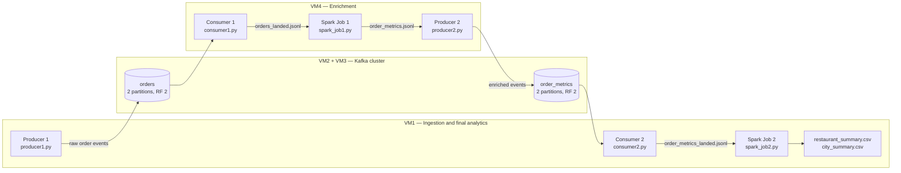

# Distributed Food Ordering System

A distributed, event-driven food-ordering data pipeline built as part of a Big Data course project. The system uses **Apache Kafka** to move order events between virtual machines and **Apache Spark (PySpark)** to validate, enrich, and aggregate delivery data.

The workload is split across four virtual machines: raw orders are ingested into Kafka, transformed into delivery-performance metrics, published to a second Kafka topic, and finally summarized into restaurant- and city-level analytics.

---

## Contents

- [Project overview](#project-overview)
- [System architecture](#system-architecture)
- [End-to-end workflow](#end-to-end-workflow)
- [Virtual machine responsibilities](#virtual-machine-responsibilities)
- [Technology stack](#technology-stack)
- [Kafka cluster design](#kafka-cluster-design)
- [Data processing implementation](#data-processing-implementation)
- [Generated outputs and demonstrated results](#generated-outputs-and-demonstrated-results)
- [Repository structure](#repository-structure)
- [Prerequisites](#prerequisites)
- [Kafka setup](#kafka-setup)
- [Running the pipeline](#running-the-pipeline)
- [Verification and broker-failure test](#verification-and-broker-failure-test)
- [Configuration notes and limitations](#configuration-notes-and-limitations)

## Project overview

The project models the data-processing workflow of a food-ordering platform. Instead of running all operations in one program, it separates ingestion, transformation, and analytics into distinct stages that communicate through Kafka.

The pipeline:

1. Reads raw order records from a JSON Lines (`.jsonl`) dataset and publishes them to Kafka.
2. Consumes the raw events from Kafka and lands them in a local JSONL file.
3. Uses PySpark to validate the records and calculate delivery-performance metrics.
4. Publishes the enriched records to a second Kafka topic.
5. Consumes the enriched events on another VM.
6. Uses a second Spark job to aggregate the data by restaurant and city and generate CSV reports.

This design demonstrates distributed messaging, broker replication, multi-stage data processing, and batch analytics.

## System architecture



Kafka is the messaging layer between processing stages. VM2 and VM3 host the Kafka brokers; VM1 and VM4 run the producers, consumers, and Spark jobs.

## End-to-end workflow

| Stage | VM / component | Input | Output |
|---|---|---|---|
| 1 | VM1 – Producer 1 | `order.jsonl` | Messages in `orders` |
| 2 | VM4 – Consumer 1 | `orders` topic | `orders_landed.jsonl` |
| 3 | VM4 – Spark Job 1 | Raw landed orders | `order_metrics.jsonl` |
| 4 | VM4 – Producer 2 | Enriched JSONL records | Messages in `order_metrics` |
| 5 | VM1 – Consumer 2 | `order_metrics` topic | `order_metrics_landed.jsonl` |
| 6 | VM1 – Spark Job 2 | Enriched landed records | Restaurant and city CSV summaries |

## Virtual machine responsibilities

| VM | Responsibility | Main files |
|---|---|---|
| **VM1** | Publishes raw orders, consumes enriched metrics, and runs final analytics | `producer1.py`, `consumer2.py`, `spark_job2.py`, `capture_offsets.py` |
| **VM2** | Kafka broker 1 and KRaft controller | `vm2/` and shared Kafka scripts |
| **VM3** | Kafka broker 2 | `vm3/` and shared Kafka scripts |
| **VM4** | Consumes raw orders, calculates delivery metrics, and republishes enriched records | `consumer1.py`, `spark_job1.py`, `producer2.py` |

VM2 and VM3 are required for normal two-broker replicated operation. In the checked-in KRaft topology, VM2 is the controller node and VM3 is broker-only.

## Technology stack

| Technology | Purpose |
|---|---|
| **Apache Kafka** | Distributed event streaming between pipeline stages |
| **KRaft** | Kafka metadata quorum management without ZooKeeper |
| **Apache Spark / PySpark** | Data validation, transformation, metric calculation, and aggregation |
| **Python** | Kafka producers, consumers, and data-processing scripts |
| **JSON / JSONL** | Input events and intermediate records |
| **CSV** | Final analytics output |
| **Ubuntu virtual machines** | Distributed execution environment |
| **ZeroTier** | Private networking between virtual machines |

## Kafka cluster design

The pipeline uses two Kafka topics:

| Topic | Purpose | Partitions | Replication factor |
|---|---|---:|---:|
| `orders` | Raw food-order events | 2 | 2 |
| `order_metrics` | Enriched delivery-performance records | 2 | 2 |

The script `scripts/create_topics.sh` creates both topics if they do not already exist and describes them after creation.

### Broker and controller roles

- **VM2 – node ID 1:** configured with `process.roles=broker,controller`, so it runs as both a broker and the KRaft controller.
- **VM3 – node ID 2:** configured with `process.roles=broker`, so it runs as a broker-only node.
- **Port 9092:** PLAINTEXT Kafka client/inter-broker listener.
- **Port 9093:** KRaft controller listener on VM2.

The configuration template sets two default partitions, replication-related settings, disables automatic topic creation, and sets `min.insync.replicas=1`. The VM4 producer that publishes enriched metrics uses `acks="all"` and retries. Effective write availability and durability depend on broker health and the active in-sync replica set (ISR); a replication factor of two by itself does not mean both replicas are always in sync.

**Controller availability note:** the checked-in quorum configuration lists VM2 as the only KRaft controller. The cluster has two brokers, but it is not a multi-controller, highly available controller quorum. Broker replication and controller high availability are different concerns.

## Data processing implementation

### 1. Raw order production – VM1

**File:** `vm1/producer1.py`

- Reads `order.jsonl` from the script's current working directory.
- Parses each non-empty line as JSON.
- Publishes each order as a message to the `orders` topic.
- Waits for each send result and reports the number of records published.
- Reads Kafka bootstrap servers from `KAFKA_BROKERS`; the code defaults to `localhost:9092`.

### 2. Raw order consumption – VM4

**File:** `vm4/consumer1.py`

- Connects to the `orders` topic and discovers its partitions.
- Assigns all discovered partitions directly to the consumer.
- Captures the current end offsets before the new batch is published, skipping messages that were already present.
- Waits for the configured batch of **62 records**.
- Checks that each message is non-empty and contains a valid JSON object.
- Writes the complete batch to `orders_landed.jsonl` using a temporary file followed by an atomic replacement.

The current script has a fixed bootstrap-server address and expected batch size. Update these when deploying with a different network or dataset.

### 3. Order validation and metric generation – VM4

**File:** `vm4/spark_job1.py`

The first Spark job reads the landed JSONL file using an explicit schema and parses the order, acceptance, pickup, expected-delivery, and delivered timestamps.

**Validation and filtering**

- Drops records with missing required fields.
- Keeps records with positive distance and order amount, non-negative delivery fee, and `DELIVERED` status.
- Removes exact duplicate records.
- Rejects invalid time intervals and records with non-positive delivery duration.

**Calculated metrics**

| Metric | Calculation |
|---|---|
| Preparation time | Pickup timestamp − acceptance timestamp |
| Delivery time | Delivered timestamp − pickup timestamp |
| Fulfilment time | Delivered timestamp − order timestamp |
| Delivery speed | Distance divided by delivery duration in hours |
| Delay | Positive difference between actual and expected delivery timestamps |

**Delay classification**

- `ON_TIME`: no delay.
- `SLIGHT_DELAY`: delay of up to 15 minutes.
- `MODERATE_DELAY`: delay greater than 15 and up to 30 minutes.
- `SEVERE_DELAY`: delay greater than 30 minutes.

The job writes enriched records to `order_metrics.jsonl`. The output includes order, customer, restaurant, and delivery-partner identifiers; city; order amount; delivery fee; distance; calculated time and speed metrics; delay minutes; delivery status; and delay category.

### 4. Enriched metric production – VM4

**File:** `vm4/producer2.py`

- Reads `order_metrics.jsonl`.
- Parses each non-empty line as JSON.
- Publishes the enriched records to `order_metrics`.
- Uses `acks="all"` and retries, then reports the number of records sent.

### 5. Enriched metric consumption – VM1

**File:** `vm1/consumer2.py`

- Consumes records from `order_metrics` and writes them to `order_metrics_landed.jsonl`.
- Supports normal earliest-offset subscription.
- Supports an optional saved-offset mode when `USE_SAVED_OFFSETS=1`, using `order_metrics_offsets.json`.
- In saved-offset mode, checks that the saved partition list matches the topic and that offsets are within the available beginning/end offset range.
- Requires `EXPECTED_COUNT` and raises an error if the expected batch is incomplete.

The helper `vm1/capture_offsets.py` records the current end offset for each `order_metrics` partition in `order_metrics_offsets.json`. The saved-offset mode in `consumer2.py` can then seek to those positions.

### 6. Final analytics – VM1

**File:** `vm1/spark_job2.py`

The second Spark job reads the enriched JSONL records, removes duplicate rows, and aggregates the data in two ways.

**`restaurant_summary.csv`** contains:

- Order count per restaurant
- Average order amount
- Average preparation time
- Average delivery time
- Delayed order count
- Delay-rate percentage

**`city_summary.csv`** contains:

- Order count per city
- Average order amount
- Average delivery time
- Delayed order count
- Delay-rate percentage

Both summaries are written as CSV files with headers.

## Generated outputs and demonstrated results

| File | Description |
|---|---|
| `orders_landed.jsonl` | Raw orders consumed from Kafka on VM4 |
| `order_metrics.jsonl` | Cleaned and enriched order records generated by Spark Job 1 |
| `order_metrics_landed.jsonl` | Enriched records consumed from Kafka on VM1 |
| `restaurant_summary.csv` | Restaurant-level delivery and order analytics |
| `city_summary.csv` | City-level delivery and order analytics |

In the team's demonstrated run:

- **62 raw orders** were published to `orders`.
- **44 enriched records** were consumed from `order_metrics`.
- The restaurant summary covered **6 restaurants**.
- The city summary covered **4 cities**.
- The 44 valid enriched records included **33 delayed orders**.

These counts describe the demonstrated dataset and execution, not a guarantee for every run. The reduction from raw to enriched records reflects the validation and filtering performed by Spark Job 1.

## Repository structure

```text
.
├── README.md
├── .gitignore
├── kafka/
│   └── server.properties.template
├── scripts/
│   ├── check_config.sh
│   ├── common.sh
│   ├── create_topics.sh
│   ├── initialize_storage.sh
│   ├── render_config.sh
│   ├── start.sh
│   ├── stop.sh
│   └── verify_cluster.sh
├── vm1/
│   ├── README.md
│   ├── order.jsonl
│   ├── producer1.py
│   ├── consumer2.py
│   ├── capture_offsets.py
│   └── spark_job2.py
├── vm2/
│   ├── setup.sh
│   ├── start.sh
│   └── stop.sh
├── vm3/
│   ├── setup.sh
│   ├── start.sh
│   └── stop.sh
└── vm4/
    ├── consumer1.py
    ├── spark_job1.py
    └── producer2.py
```

## Prerequisites

The repository contains project scripts and application code; it does not automatically install the complete runtime environment. Prepare:

- Ubuntu VMs with private network connectivity between participating machines.
- ZeroTier (or the lab's configured private network) connected on the required VMs.
- A compatible Java runtime.
- Apache Kafka installed at `/opt/kafka` on broker VMs, unless `KAFKA_HOME` is configured to another location.
- Apache Spark / PySpark available on the VMs running Spark jobs.
- Python 3 and the `kafka-python` package on machines running Kafka producers and consumers.
- The input dataset and expected working-directory layout.

Example Python package installation:

```bash
python3 -m pip install kafka-python pyspark
```

Use Java and Spark versions compatible with the installed PySpark distribution.

## Kafka setup

### 1. Render broker configuration

The template is `kafka/server.properties.template`. Run the setup script on each broker VM:

```bash
# On VM2
bash vm2/setup.sh

# On VM3
bash vm3/setup.sh
```

Review the generated properties and confirm that the advertised broker addresses and controller quorum address match the current private-network IP addresses. The renderer accepts overrides such as `CONTROLLER_IP`, `BROKER1_IP`, and `BROKER2_IP`.

### 2. Initialize storage only for a fresh cluster

`scripts/initialize_storage.sh` is intended only for a **new cluster with new, empty data directories**. It formats Kafka storage using a shared cluster ID and refuses to format a non-empty target.

> **Do not point this script at existing Kafka data. It is not an in-place broker-repair or recovery command.**

Only after the team has explicitly decided to create a fresh cluster and verified that the configured storage directories are new and empty:

1. Generate one new cluster ID on VM2 using Kafka's `kafka-storage.sh random-uuid`.
2. Make the same cluster ID available on VM2 and VM3.
3. Set `CLUSTER_ID` on each VM.
4. Run the initialization script on each VM.

```bash
export CLUSTER_ID='YOUR_NEW_SHARED_CLUSTER_ID'
bash scripts/initialize_storage.sh
```

Never run these steps against the previously used cluster's data directories.

### 3. Start brokers and create topics

Start VM2 (controller and broker) first, then VM3:

```bash
# VM2
bash vm2/start.sh

# VM3
bash vm3/start.sh
```

After both brokers are reachable, create and inspect the topics:

```bash
bash scripts/create_topics.sh
bash scripts/verify_cluster.sh
```

The scripts use repository defaults for Kafka paths and broker addresses. Set `KAFKA_HOME` or `BS` if your deployment differs.

## Running the pipeline

Start consumers before publishing the batch they are expected to receive:

1. Start **VM4 Consumer 1** and wait for its ready message.
2. Run **VM1 Producer 1** to publish the raw order batch.
3. Wait for Consumer 1 to write `orders_landed.jsonl` on VM4.
4. Run **VM4 Spark Job 1** to generate `order_metrics.jsonl`.
5. Run **VM4 Producer 2** to publish the enriched metrics.
6. Start **VM1 Consumer 2** with `EXPECTED_COUNT` set to the expected enriched-record count.
7. Run **VM1 Spark Job 2** to generate the final CSV summaries.

Typical commands are shown below. Run them from the directory containing the relevant files and after configuring broker addresses and paths for your environment.

```bash
# VM1: publish raw orders
python3 producer1.py

# VM4: consume, transform, and republish
python3 consumer1.py
python3 spark_job1.py
python3 producer2.py

# VM1: consume enriched records
EXPECTED_COUNT=44 python3 consumer2.py

# VM1: generate final summaries
python3 spark_job2.py
```

This is a stage-by-stage workflow, not a one-command deployment. VM4 scripts currently use fixed paths under `~/food-ordering` and a configured bootstrap address. VM1 scripts use paths relative to the current working directory and read broker addresses from `KAFKA_BROKERS` (default `localhost:9092`). Ensure files are placed correctly and settings are consistent before execution.

## Verification and broker-failure test

**Check broker listeners**

```bash
sudo ss -lntp | grep -E ':9092|:9093'
```

**Inspect KRaft quorum status**

```bash
/opt/kafka/bin/kafka-metadata-quorum.sh \\
  --bootstrap-controller CONTROLLER_IP:9093 describe --status
```

**Inspect topic partitions and ISR**

```bash
/opt/kafka/bin/kafka-topics.sh \\
  --bootstrap-server BROKER_IP:9092 --describe --topic orders

/opt/kafka/bin/kafka-topics.sh \\
  --bootstrap-server BROKER_IP:9092 --describe --topic order_metrics
```

For a broker-failure demonstration:

1. Verify both topics are healthy and record their partition and ISR information.
2. Stop the broker selected for the test.
3. Check whether the remaining broker continues to serve the topic operations being tested.
4. Restart the stopped broker.
5. Verify that replica synchronization recovers.

**VM2 is the sole KRaft controller in this topology. Do not stop VM2 during a test intended to demonstrate broker-only failure tolerance.** Results depend on controller availability, partition leadership, ISR membership, and the operation being tested. Capture command output and logs before, during, and after the test.

## Configuration notes and limitations

- **Fresh-cluster scripts:** setup and storage initialization scripts are for a new cluster and new empty storage directories, not in-place repair of an existing cluster.
- **IP addresses:** scripts contain private-network defaults for the lab. Update them when VM addresses change.
- **File paths:** VM4 scripts expect files under `~/food-ordering`; VM1 scripts use relative paths. Run from the correct directory or update paths deliberately.
- **Batch sizes:** VM4 Consumer 1 currently expects 62 raw records. VM1 Consumer 2 requires `EXPECTED_COUNT`. Update these for another dataset.
- **Offsets:** VM1 Consumer 2 supports earliest-offset mode and optional saved offsets. Choose the intended mode deliberately.
- **Spark execution mode:** both Spark jobs are configured with `.master("local[*]")`. Spark uses the available cores on the VM running the job; this repository does not configure a multi-node Spark cluster.
- **Orchestration:** the repository contains individual scripts; it does not currently include a single end-to-end launcher.
- **Controller HA:** the configured KRaft quorum has one controller (VM2). Two broker replicas do not make the controller quorum highly available.
- **Repository hygiene:** do not commit credentials, tokens, or private machine configuration. Review input data before publishing it to a public repository.

---

**Project focus:** distributed event streaming, Kafka replication, KRaft-based broker coordination, Spark transformations, and delivery-performance analytics.
